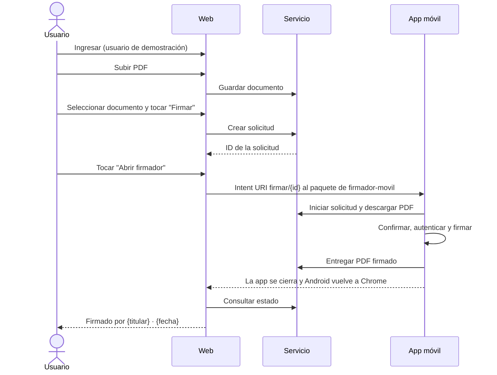

# 🌐 Firmador cliente

Web _mobile-first_ en HTML, CSS y JavaScript, sin framework ni dependencias, que simula un **sistema de gestión documental interno**: el usuario ingresa, sube un PDF, lo firma desde Android o computadora y consulta las firmas aplicadas.

> ⚠️ **Prueba de concepto académica.** La web no firma ni maneja claves privadas. En Android, la firma ocurre en `firmador-movil`; en computadora, la web llama al servicio local de Jacobitus Escritorio. La identidad sale del certificado usado, no de la sesión web. Solo se implementan los casos ideales; un fallo muestra un mensaje genérico.

## 🎓 Contexto

Parte de la prueba de concepto de la monografía *Estrategias basadas en PMBOK 7 con un enfoque adaptativo para la incorporación de dispositivos móviles en el servicio de firma digital de la Entidad Certificadora Pública AGETIC, orientadas a la entrega de valor al cliente* (Maestría en Transformación Digital y Gestión de Proyectos Tecnológicos, Universidad Mayor de San Andrés, 2026). Junto con [`firmador-servicio`](https://github.com/AlexQuispe/firmador-servicio), forma el sistema de gestión documental de ejemplo con el que se probó que [`firmador-movil`](https://github.com/AlexQuispe/firmador-movil) puede atender firmas solicitadas desde otro sistema: el escenario de una entidad usuaria, como AGETIC con su Sistema de Plantillas.

## 🔄 Firma desde Android

El enlace solo abre la app y no devuelve nada a la web: el resultado se obtiene consultando a `firmador-servicio` al volver, nunca se asume. El botón **Actualizar** repite la consulta.

## 🖥️ Firma desde computadora

Se agregó después de la prueba de integración y no se evaluó en la monografía. En Chrome, **Firmar** abre una hoja con el documento, su SHA-256, el token conectado y un campo para el PIN. Tras cargar y elegir el certificado, la web envía el PDF a la API local configurada en `JACOBITUS_URL`, recibe el PDF firmado y lo entrega a `firmador-servicio`. El PIN solo se usa en memoria durante esa operación.

Jacobitus debe estar abierto en la computadora. La web se abre como `http://localhost:8080` o mediante HTTPS; en Chrome puede aparecer un permiso para acceder a la red local. El manual de [instalación](INSTALL.md) detalla los orígenes CORS para escritorio y Android.

## 🧩 Funciones

- Ingreso simulado con usuarios fijos, rotulado como entorno de demostración (FC-01).
- Lista de documentos con nombre, tamaño, fecha, quién lo subió, estado (`Sin firma`, `Firma en curso`, `Firmado (n)`, `Rechazada`) y último firmante (FC-02).
- Carga de PDF desde el selector de archivos del teléfono (FC-03).
- **Firmar** crea la solicitud y **Abrir firmador** abre la app con un toque del usuario, sin apertura automática (FC-04).
- En escritorio, **Firmar** llama a Jacobitus y registra el PDF firmado en el servicio (FC-11).
- Detección del resultado al volver al navegador y marca del documento con titular y fecha (FC-05, FC-06).
- Detalle con metadatos, SHA-256 y una tarjeta por firma: titular, emisor y fecha declarada por el firmante (PAdES B-B) (FC-07).
- Descarga de la versión actual del documento (FC-08).

Titular, emisor y fecha salen de lo que `firmador-servicio` extrae del PDF firmado. La nota de CA de laboratorio solo aparece cuando el emisor extraído indica «laboratorio». El servicio extrae metadatos, pero no valida la firma ni la cadena de certificados; la web no muestra «Firma válida».

También muestra los eventos de la solicitud con su hora (FC-09). Las validaciones con mensajes específicos (FC-10) no se implementaron.

## ✅ Qué se comprobó

En la prueba de integración (25 de octubre de 2026), un Samsung Galaxy S23 Ultra con Android 16 y Chrome atendió tres solicitudes: la primera se firmó, la segunda se rechazó en el teléfono y la tercera agregó una segunda firma al documento de la primera. Las catorce comparaciones del SHA-256 entre lo que entregó el servicio, lo que firmó el teléfono y lo que guardó el servicio coincidieron; el rechazo no modificó el documento y la segunda firma no alteró la primera.

Es un sistema de ejemplo, no preparado para un uso real: la solicitud se atiende solo con su ID, sin clave de acceso ni vencimiento; el servicio acepta dos veces el mismo resultado; y la comunicación no está cifrada.

## 🏷️ Versión evaluada

| Prueba                            | Commit |
| --------------------------------- | ------ |
| Prueba de integración (iteración I5) | [`879e8ca`](https://github.com/AlexQuispe/firmador-cliente/tree/879e8ca4377fda42387365349859fd6b0048c752) |

Los cambios posteriores (firma desde computadora con Jacobitus, ajustes visuales y documentación) no se evaluaron en la monografía.

📄 Detalle: [Especificaciones técnicas](docs/ESPECIFICACIONES_TECNICAS.md) · 🛠️ Instalación: [INSTALL.md](INSTALL.md) · 📜 [Licencia LPG-Bolivia v1.1](LICENSE)
