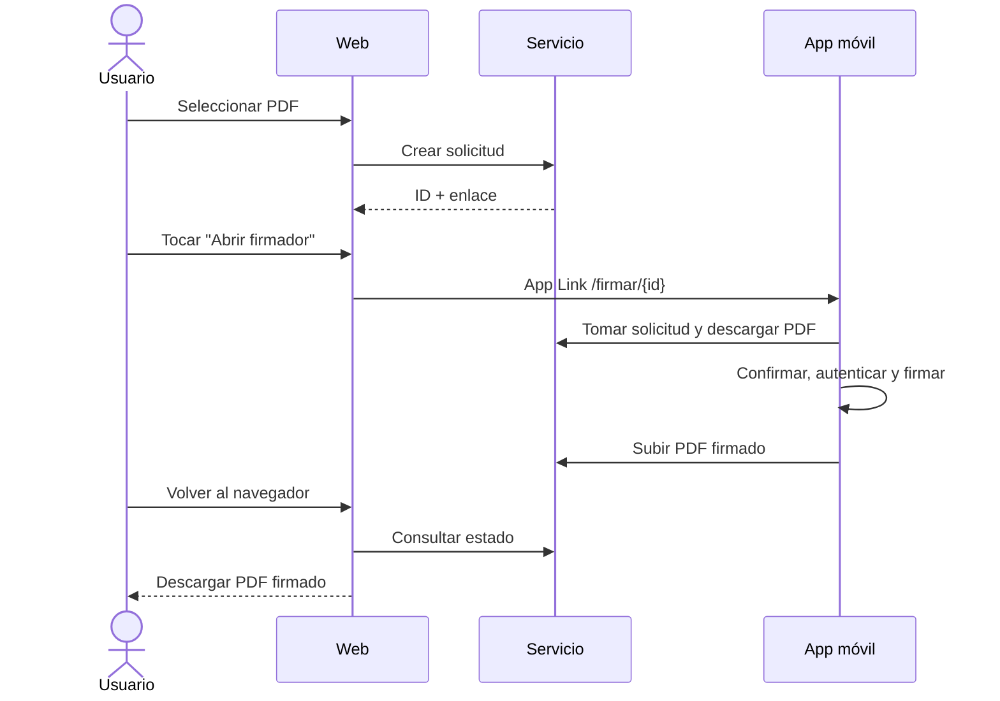

# 🌐 Firmador cliente

Web _mobile-first_ (Next.js + TypeScript) que simula un **sistema documental de ejemplo**: el usuario sube un PDF, abre el firmador del teléfono y descarga el documento firmado.

> ⚠️ **Prueba de concepto, prioridad P2.** El navegador **no** accede a la clave ni firma. Toda la criptografía ocurre en `firmador-movil`.

## 🔄 Flujo en un mismo teléfono

## ✅ Funciones

- Subir un PDF y mostrar nombre, tamaño y SHA-256.
- Crear la solicitud y mostrar el botón **Abrir firmador móvil**.
- Recuperar el estado al volver al navegador, sin duplicar la solicitud.
- Descargar el resultado o explicar el rechazo, la expiración o la falta de la app.

## 🎯 Aporte a la monografía

Junto con `firmador-servicio`, permite evaluar **RF07**: la firma solicitada desde un sistema documental, el escenario de AGETIC como entidad usuaria. No es necesaria para evaluar el núcleo (firma local en el teléfono).

📄 Detalle: [Especificaciones técnicas](docs/ESPECIFICACIONES_TECNICAS.md)
