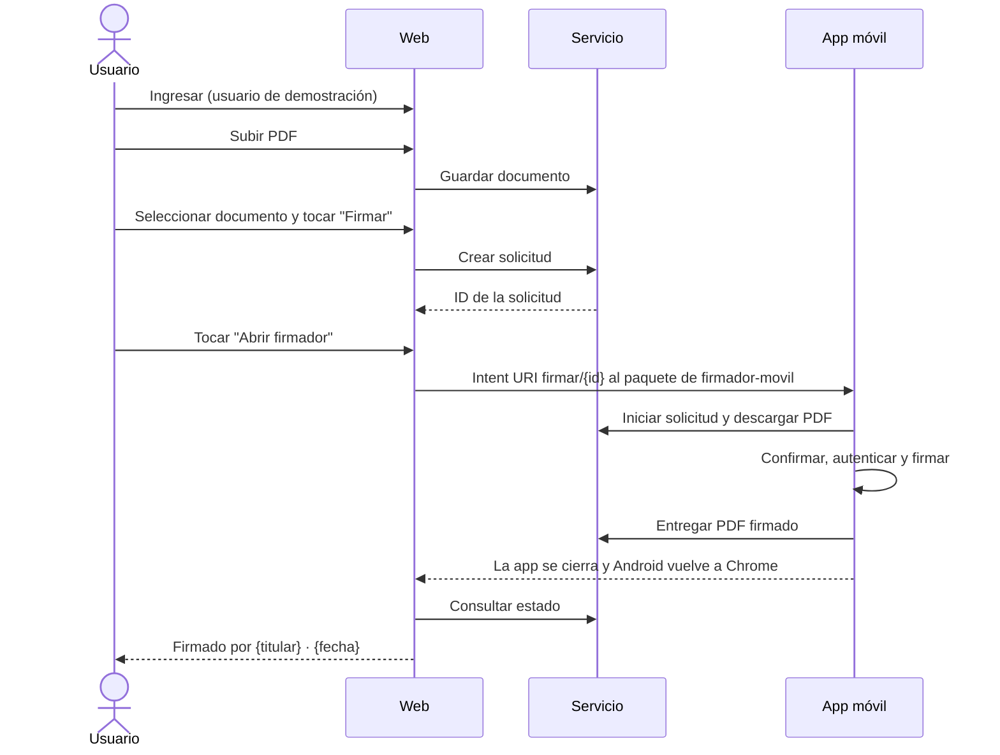

# 🌐 Firmador cliente

Web _mobile-first_ en HTML, CSS y JavaScript, sin framework ni dependencias, que simula un **sistema de gestión documental interno**: el usuario ingresa, sube un PDF, lo firma desde Android o computadora y consulta las firmas aplicadas.

> ⚠️ **Prueba de concepto, prioridad P2.** La web no firma ni maneja claves privadas. En Android, la firma ocurre en `firmador-movil`; en computadora, la web llama al servicio local de Jacobitus Escritorio. La identidad sale del certificado usado, no de la sesión web. Solo se implementan los casos ideales; un fallo muestra un mensaje genérico.

## 🔄 Firma desde Android

El enlace solo abre la app y no devuelve nada a la web: el resultado se obtiene consultando a `firmador-servicio` al volver, nunca se asume. El botón **Actualizar** repite la consulta.

## 🖥️ Firma desde computadora

En Chrome, **Firmar** abre una hoja con el documento, su SHA-256, el token conectado y un campo para el PIN. Tras cargar y elegir el certificado, la web envía el PDF a la API local configurada en `JACOBITUS_URL`, recibe el PDF firmado y lo entrega a `firmador-servicio`. El PIN solo se usa en memoria durante esa operación.

Jacobitus debe estar abierto en la computadora. La web se abre como `http://localhost:8080` o mediante HTTPS; en Chrome puede aparecer un permiso para acceder a la red local. El manual de [instalación](INSTALL.md) detalla los orígenes CORS para escritorio y Android.

## ✅ Funciones (P2)

- Ingreso simulado con usuarios fijos, rotulado como entorno de demostración (FC-01).
- Lista de documentos con nombre, tamaño, fecha, quién lo subió, estado (`Sin firma`, `Firma en curso`, `Firmado (n)`, `Rechazada`) y último firmante (FC-02).
- Carga de PDF desde el selector de archivos del teléfono (FC-03).
- **Firmar** crea la solicitud y **Abrir firmador** abre la app con un toque del usuario, sin apertura automática (FC-04).
- En escritorio, **Firmar** llama a Jacobitus y registra el PDF firmado en el servicio (FC-11).
- Detección del resultado al volver al navegador y marca del documento con titular y fecha (FC-05, FC-06).
- Detalle con metadatos, SHA-256 y una tarjeta por firma: titular, emisor y fecha declarada por el firmante (PAdES B-B) (FC-07).
- Descarga de la versión actual del documento (FC-08).

Titular, emisor y fecha salen de lo que `firmador-servicio` extrae del PDF firmado. La nota de CA de laboratorio solo aparece cuando el emisor extraído indica «laboratorio». El servicio extrae metadatos, pero no valida la firma ni la cadena de certificados; la web no muestra «Firma válida».

Los eventos de la solicitud (FC-09) y las validaciones con mensajes específicos (FC-10) son P3: solo si P2 queda cerrado y hay tiempo.

## 🎯 Aporte a la monografía

Junto con `firmador-servicio`, aporta evidencia descriptiva al requisito **RF07** y al criterio **V5**: la firma solicitada desde un sistema documental, el escenario de AGETIC como entidad usuaria. No es necesaria para evaluar el núcleo (firma local en el teléfono) ni permite afirmar facilidad de uso o ahorro de tiempo, porque no hay pruebas con usuarios.

📄 Detalle: [Especificaciones técnicas](docs/ESPECIFICACIONES_TECNICAS.md) · 🛠️ Instalación: [INSTALL.md](INSTALL.md)
