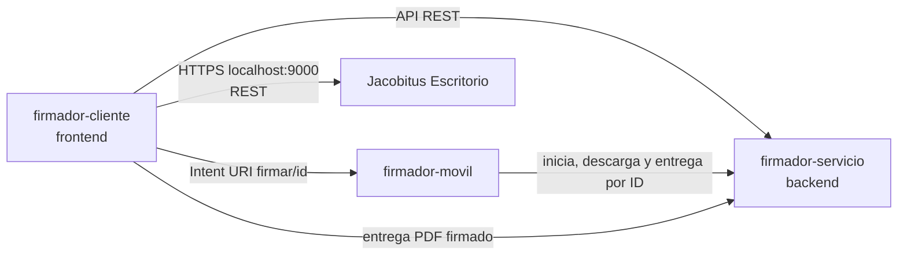

# Especificaciones técnicas — Firmador cliente

**Versión:** 0.4 · **Estado:** implementado y probado · **Prioridad:** P2 · **Trazabilidad:** requisito RF07 y criterio V5 de la monografía (apartados 3.2.2 y 3.2.6).

## 1. Alcance

Web _mobile-first_ que simula un **sistema de gestión documental interno** con lo mínimo para las pruebas: ingreso simulado, lista de documentos, carga de PDF, solicitud de firma desde Android o escritorio y detalle de las firmas. El frontend y el backend corren en un equipo (la laptop o un servidor con dominio). En Android se usa Chrome y `firmador-movil`; en escritorio se usa un navegador con `Jacobitus Escritorio` ejecutándose en ese mismo equipo.

La web no firma, no maneja claves privadas y no emite certificados. La identidad del firmante sale del certificado usado por Firmador Móvil o Jacobitus Escritorio, nunca de la sesión web.

**Simplificación declarada:** se implementan solo los casos ideales. Sin validaciones de entrada ni manejo detallado de errores; un fallo se muestra con un mensaje genérico. Única excepción: si el servicio responde `404` a la consulta de la solicitud guardada, la web la descarta sin aviso. Las validaciones no se implementaron.

## 2. Arquitectura

- El frontend consume la API de `firmador-servicio`. Los PDF los guarda y los entrega el servicio.
- **Ingreso simulado:** usuarios fijos de demostración. El usuario de la sesión se envía al servicio para registrar quién sube y quién solicita. No es un control de seguridad.
- **Estado de la firma:** en Android, el Intent URI solo abre la app y no devuelve nada a la web. Al terminar, Android vuelve al navegador y la web consulta el estado en `firmador-servicio`; **Actualizar** permite repetir la consulta. En escritorio, el navegador llama al servicio HTTPS local de Jacobitus Escritorio, recibe el PDF firmado y lo entrega a `firmador-servicio`; después consulta el estado.
- **Integración de escritorio:** la web consulta tokens y certificados conectados y llama a `POST /api/token/firmar_pdf` de Jacobitus Escritorio. El PIN se mantiene solo durante la operación; no se guarda en el navegador. La API local documentada por Jacobitus escucha en `https://localhost:9000`.
- **Datos de la firma:** los extrae `firmador-servicio` del PDF firmado; la web solo los muestra.

## 3. Vistas

| Vista      | Contenido                                                                 | Acciones                                    |
| ---------- | ------------------------------------------------------------------------- | ------------------------------------------- |
| Ingreso    | Nombre del sistema, aviso «entorno de demostración», usuario y contraseña | Ingresar                                    |
| Documentos | Lista: nombre, tamaño, fecha, subido por, estado y último firmante        | Subir PDF, seleccionar uno, Firmar, Detalle |
| Detalle    | Metadatos y SHA-256, firmas aplicadas, eventos de la solicitud            | Firmar, descargar                           |

**Interacción (Material Design 3):**

- Barra superior con el título, el usuario, **Actualizar** y un botón para salir.
- FAB extendido «Subir PDF», que abre el selector de archivos del teléfono filtrado a PDF.
- Tocar una fila la selecciona (una a la vez) y aparece una barra inferior con **Firmar** y **Ver detalle**.
- En Android, **Firmar** crea la solicitud y abre una hoja inferior con nombre, SHA-256 abreviado y el botón **Abrir firmador**. Son dos toques a propósito: la app se abre con un gesto directo del usuario y no después de una espera de red, que Chrome puede bloquear.
- En escritorio, **Firmar** abre una hoja con nombre, SHA-256, selector de token y PIN. Tras cargar los certificados, el usuario elige uno y toca **Firmar con Jacobitus**. La hoja muestra un mensaje genérico si Jacobitus no está disponible.
- Estado de la fila como _chip_: `Sin firma`, `Firma en curso`, `Firmado (n)`, `Rechazada`.
- Al detectarse una firma nueva, la fila se resalta unos segundos y aparece un _snackbar_ «Firmado por {titular}». La fila conserva un ícono de sello y el texto «{titular} · {fecha}».
- En el detalle, cada firma es una tarjeta con titular, emisor y fecha declarada. La nota de CA de laboratorio aparece solo cuando el emisor extraído del certificado indica «laboratorio». No se muestra «Firma válida»: el servicio extrae metadatos, pero no valida la firma ni la cadena de certificados.

## 4. Requisitos

| ID    | Requisito                                                                | Prioridad | Verificación                      |
| ----- | ------------------------------------------------------------------------ | --------- | --------------------------------- |
| FC-01 | Ingresar con un usuario de demostración                                  | P2        | Prueba en el S23 Ultra            |
| FC-02 | Listar los documentos con su estado de firma                             | P2        | Prueba en el S23 Ultra            |
| FC-03 | Subir un PDF                                                             | P2        | Documento nuevo en la lista       |
| FC-04 | Seleccionar un documento y abrir Firmador Móvil con un botón del usuario | P2        | Apertura verificada               |
| FC-05 | Detectar el resultado al volver al navegador                             | P2        | Prueba web → app → web            |
| FC-06 | Marcar el documento firmado con titular y fecha                          | P2        | Comparación con el certificado    |
| FC-07 | Mostrar el detalle de cada firma                                         | P2        | Comparación con validador externo |
| FC-08 | Descargar la versión actual del documento                                | P2        | Archivo abierto en el teléfono    |
| FC-09 | Mostrar los eventos de la solicitud con su hora                          | P3        | Registro de un caso completo      |
| FC-10 | Validaciones y mensajes de error específicos                             | P3        | Casos inválidos                   |
| FC-11 | Firmar desde escritorio con Jacobitus y registrar el resultado           | P2        | Prueba web → Jacobitus → web      |

Todos están implementados, salvo FC-10. FC-11 se agregó después de la prueba de integración y no se evaluó en la monografía.

## 5. Reglas

- 📱 _Mobile-first_: diseñar a 360 px, objetivos táctiles de 48 px, contraste legible, tema claro y oscuro según el sistema.
- 🚫 La app móvil se abre solo al tocar su botón. El PIN de Jacobitus se usa en memoria para la operación y nunca se almacena.
- 🔁 Al volver, consultar el estado; nunca asumir que la firma se completó.
- 🧾 La fecha mostrada es la **declarada por el firmante** (PAdES B-B) y se rotula así.
- 👤 «Subido por» y «solicitado por» vienen de la sesión simulada; «firmado por» viene solo del certificado.

## 6. Evaluación

Registrar por caso: Chrome y Android en móvil; sistema operativo, Chrome y Jacobitus Escritorio en computadora; documento, resultado y horas de creación de la solicitud, inicio de la firma y resultado. Aporta evidencia descriptiva a RF07 y V5. No afirmar facilidad de uso ni ahorro de tiempo: no hay pruebas con usuarios (monografía, apartado 1.5.2).

## 7. Fuera de alcance

Autenticación real, validaciones, casos de error, firma en el navegador, firma visible, firma por lotes, vista previa del PDF, flujo desde computadora con código QR y producción.
